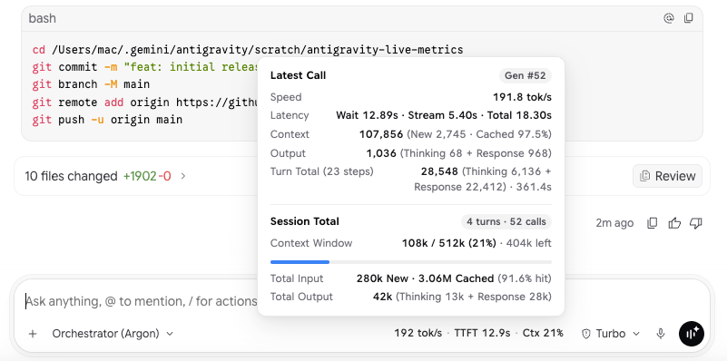

# Antigravity Live Metrics

A lightweight, zero-bloat runtime overlay for **Google Antigravity** that displays real-time **token speed (`tok/s`)**, **latency (`TTFT` / `Hold`)**, and **context window usage (`Ctx %`)** right next to the mode selector (`Turbo`), along with a clean multi-language hover card for detailed token and cache statistics.



## Features

- **Minimal & Native-Blending**: Adds only 3 concise metrics (`tok/s · TTFT/Hold · Ctx %`) on the right side next to `Turbo`—no theme overrides, no border changes, and no font overrides.
- **Clean Hover Tooltip**: Hovering over the metrics reveals a structured breakdown:
  - **Latest Call**: Speed (`tok/s`), Latency (`Wait · Stream · Total`), Context (`New · Cached %`), Output (`Thinking + Response`), and Turn Total.
  - **Session Total**: Context Window progress bar (`used / limit · remaining`), Total Input & Cache Hit Rate, and Total Output (`Thinking + Response`).
- **Multi-language Support**: Built-in `auto` locale detection plus explicit `en`, `zh-CN`, `zh-TW`, and `ja` support.
- **Light & Dark Mode**: Automatically adapts to Antigravity's native light and dark themes.
- **O(1) Incremental SQLite Reader**: Reads Antigravity's local conversation database in read-only mode via Node's built-in `node:sqlite`.

## Requirements

- **Node.js `>= 22.13.0`** (uses built-in `node:sqlite` and native `WebSocket`)
- **Google Antigravity** running with `DevToolsActivePort` (enabled by default on `2.31+`) or CDP port `9222`

## Quick Start

```bash
git clone https://github.com/Dexku/antigravity-live-metrics.git
cd antigravity-live-metrics

# Install and start the background daemon
node bin/cli.mjs install

# Verify live injection
node bin/cli.mjs verify
```

## Configuration

Configuration is stored at `~/.antigravity-live-metrics/config.json` and hot-reloads automatically within ~2.5s:

```json
{
  "channel": "auto",
  "lang": "auto",
  "contextLimit": 256000,
  "contextLimitOverride": 0
}
```

Switch tooltip language via CLI:

```bash
node bin/cli.mjs lang en      # English
node bin/cli.mjs lang zh-CN   # 简体中文
node bin/cli.mjs lang zh-TW   # 繁體中文
node bin/cli.mjs lang ja      # 日本語
node bin/cli.mjs lang auto    # Auto-detect from system/UI locale
```

## CLI Commands

```bash
node bin/cli.mjs install         # Install and start background daemon (LaunchAgent / systemd / schtasks)
node bin/cli.mjs verify          # Inject once and verify live status
node bin/cli.mjs doctor          # Check Node.js SQLite support and live window state
node bin/cli.mjs lang <locale>   # Set tooltip language
node bin/cli.mjs uninstall       # Stop daemon and remove injected UI
```

## Uninstall

```bash
node bin/cli.mjs uninstall
```

## License

[MIT](LICENSE)
