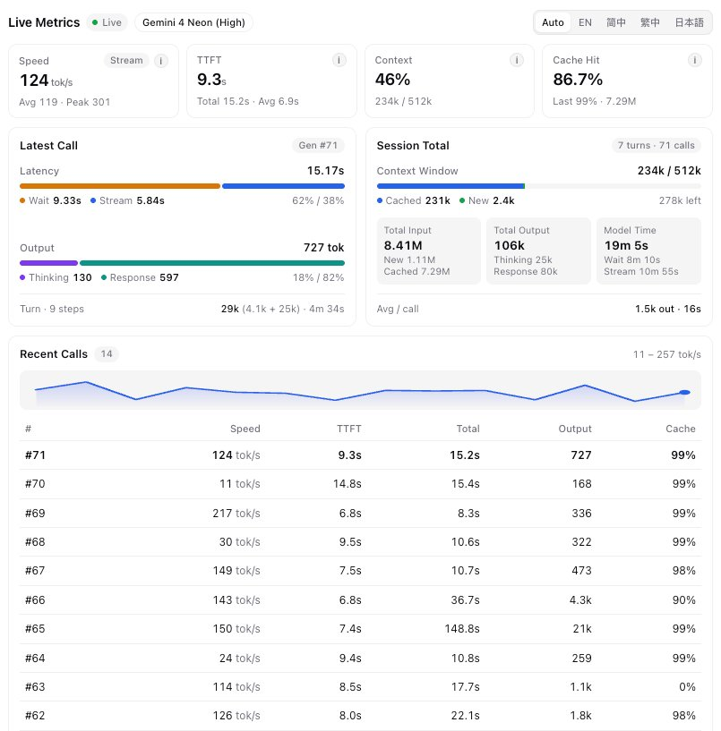

# Antigravity Live Metrics

A native **Google Antigravity UI Plugin** (Sidecar Aux Pane) that displays real-time **token speed (`tok/s`)**, **latency (`TTFT` / `Stream`)**, **context window usage**, **cache hit efficiency**, and **recent call trends** for the active conversation—with zero CDP injection and full compatibility with **Antigravity `2.33.0+`**.



## What's New in v2.0

Antigravity `2.33.0+` disabled default CDP remote debugging (`DevToolsActivePort` / `--remote-debugging-port`). Starting with **v2.0**, `antigravity-live-metrics` runs as an official **Antigravity Sidecar Web UI Plugin** (`SIDECAR_UI_ENTRYPOINT_AUX_PANE`) directly inside Antigravity's Auxiliary Pane—no external daemon, no CDP port, and resilient across app updates.

## Features

- **Native Aux Pane Integration**: Automatically tracks the active conversation and syncs with Antigravity's light and dark theme tokens.
- **4-Card KPI Overview**: Speed (`tok/s` with session avg & peak), TTFT / Hold latency, Context Window usage (`%` + ratio), and Cache Hit rate.
- **Visual Breakdowns**:
  - **Latest Call**: Wait vs. Stream proportion bar, Thinking vs. Response output bar, and multi-step Turn Total summary.
  - **Session Total**: Stacked Context Window meter (Cached vs. New vs. Remaining), Total Input, Total Output, cumulative Model Time, and per-call averages.
  - **Recent Calls**: Speed trend SVG sparkline plus a clean table of the latest generation calls.
- **Hover Detail Popovers**: Hover or click any KPI info badge (`i`) or call number (`#Gen`) to inspect exact token counts, model name, thinking/response split, and latency breakdown.
- **Multi-Language Switcher**: Instant one-click switching between `Auto`, `EN`, `简中`, `繁中`, and `日本語`.
- **O(1) Incremental SQLite Reader**: Reads Antigravity's local conversation database in read-only mode via Node's built-in `node:sqlite`.

## Requirements

- **Google Antigravity 2.0+** (Sidecar UI plugin runtime)
- **Node.js `>= 22.13.0`** (uses built-in `node:sqlite`)

## Installation

### Option 1: Install via CLI (recommended, also cleans up legacy v1 CDP daemon)

```bash
git clone https://github.com/Dexku/antigravity-live-metrics.git
cd antigravity-live-metrics
node bin/cli.mjs install
```

### Option 2: Install via `agy plugin`

```bash
agy plugin install https://github.com/Dexku/antigravity-live-metrics.git
```

Once installed, open **Live Metrics** in Antigravity's Auxiliary Pane (or manage it under **Customizations → Plugins → Live Metrics**).

## Configuration

Configuration is stored at `~/.antigravity-live-metrics/config.json`:

```json
{
  "channel": "auto",
  "lang": "auto",
  "contextLimit": 256000,
  "contextLimitOverride": 0
}
```

You can switch languages directly in the top-right bar of the panel or via CLI:

```bash
node bin/cli.mjs lang auto    # Auto-detect
node bin/cli.mjs lang en      # English
node bin/cli.mjs lang zh-CN   # 简体中文
node bin/cli.mjs lang zh-TW   # 繁體中文
node bin/cli.mjs lang ja      # 日本語
```

## CLI Commands

```bash
node bin/cli.mjs install           # Install native UI plugin and clean up legacy v1 CDP daemon
node bin/cli.mjs doctor            # Check SQLite support and plugin installation status
node bin/cli.mjs lang <locale>     # Set panel language
node bin/cli.mjs uninstall         # Remove plugin and stop any legacy v1 daemon
```

## License

[MIT](LICENSE)
